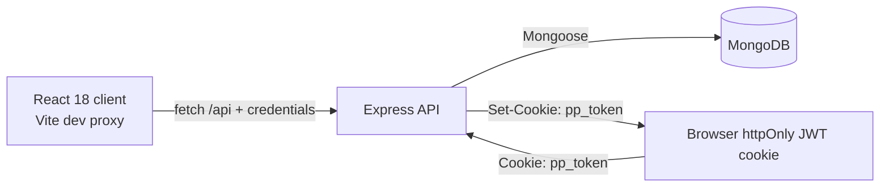

# PlanPilot

> A full-stack task-management workspace for clearer planning and follow-through.

[](https://github.com/Bilal-Nazir-3360/PlanPilot/actions/workflows/ci.yml)
[](https://react.dev/)
[](https://vite.dev/)
[](https://expressjs.com/)
[](https://www.mongodb.com/)
[](https://motion.dev/)


PlanPilot is a full-stack MERN task manager with a React workspace, an Express API, MongoDB persistence, and a demo billing system. It does not process real payments. There is no live deployment; run it locally from this GitHub repository.

## Features

### Public site

- Home, Features, Pricing, Reviews, About, Contact, Privacy, and Terms pages.
- Public sample reviews, optional authenticated review submission, and owner-only review editing/deletion.
- Contact message submission with validation and rate limiting.

### Workspace

- Signup, login, logout, session lookup, and protected dashboard routes.
- Task CRUD with Todo, In progress, and Done statuses, priorities, due dates, projects, tags, search, filters, and drag-and-drop ordering.
- Project CRUD, task progress, team-member CRUD, calendar view, analytics, overview, and settings.
- Dark and light themes.

### Plans (demo)

- Free, Pro, and Team plan selection with monthly/yearly display and local change history.
- Browser-only plan limits and feature gates; no server billing permissions.
- No real payment provider or payment processing.

### Backend

- Express API for authentication, tasks, reviews, contact messages, projects, team members, and demo reset.
- MongoDB persistence through Mongoose and Zod request validation.
- Owner-scoped workspace queries and JSON error responses.

## Architecture



In development, Vite proxies `/api` requests to `http://localhost:5000`. The API signs a JWT after login or signup and stores it in the `pp_token` httpOnly cookie.

## Tech stack

**Client:** React 18, React Router 6, Vite, Framer Motion, Tailwind CSS, custom CSS, dnd-kit, Recharts, Lucide React, and React Context.

**Server:** Node.js 18+, Express 5, Mongoose, MongoDB, JSON Web Tokens, bcryptjs, Zod, cookie-parser, CORS, Helmet, Morgan, and express-rate-limit.

## Run it locally in 5 minutes

### Prerequisites

- Node.js 18.11 or newer.
- MongoDB Community running locally, or a free MongoDB Atlas connection string.

### Steps

```bash
git clone https://github.com/Bilal-Nazir-3360/PlanPilot.git
cd PlanPilot
npm install
cd server
npm install
cd ..
cp .env.example .env
cp server/.env.example server/.env
node -e "console.log(require('crypto').randomBytes(32).toString('hex'))"
```

Copy the generated value into `server/.env` as `JWT_SECRET`. Then seed the demo workspace and start both apps:

```bash
cd server
npm run seed
cd ..
npm run dev
```

The client runs at `http://localhost:5173`; the API runs at `http://localhost:5000`.

Demo login: `demo@planpilot.app` / `planpilot-demo`

The demo account is shared; restore its sample data any time with POST /api/demo/reset while signed in as the demo user.

### Environment variables

Values below are examples only. Do not commit real secrets.

**Client: `.env`**

| Variable | Example |
| --- | --- |
| `VITE_APP_NAME` | `PlanPilot` |
| `VITE_API_URL` | *(empty; uses the Vite dev proxy)* |

**Server: `server/.env`**

| Variable | Example |
| --- | --- |
| `PORT` | `5000` |
| `NODE_ENV` | `development` |
| `MONGODB_URI` | `mongodb://127.0.0.1:27017/planpilot` |
| `CLIENT_URL` | `http://localhost:5173` |
| `JWT_SECRET` | `generated-with-the-node-one-liner` |
| `JWT_EXPIRES_IN` | `7d` |
| `DEMO_PASSWORD` | `planpilot-demo` *(optional override)* |

## API reference

Paths are relative to the API origin. Auth means the `pp_token` cookie is required.

| Method | Path | Auth | Description |
| --- | --- | --- | --- |
| POST | `/api/auth/signup` | No | Create an account and set the JWT cookie. |
| POST | `/api/auth/login` | No | Sign in and set the JWT cookie. |
| POST | `/api/auth/logout` | No | Clear the JWT cookie. |
| GET | `/api/auth/me` | Yes | Return the current user. |
| GET, POST | `/api/tasks` | Yes | List or create owned tasks. |
| PATCH | `/api/tasks/reorder` | Yes | Reorder owned tasks. |
| PATCH, DELETE | `/api/tasks/:id` | Yes | Update or delete an owned task. |
| GET, POST | `/api/reviews` | GET no; POST optional | List reviews or create one. |
| PATCH, DELETE | `/api/reviews/:id` | Yes | Update or delete the signed-in user's non-sample review. |
| POST | `/api/contact` | No | Save a contact message. |
| GET, POST | `/api/projects` | Yes | List or create owned projects. |
| GET, PATCH, DELETE | `/api/projects/:id` | Yes | Read, update, or delete an owned project. |
| GET, POST | `/api/team` | Yes | List or create owned team members. |
| GET, PATCH, DELETE | `/api/team/:id` | Yes | Read, update, or delete an owned team member. |
| POST | `/api/demo/reset` | Yes; demo user only | Reset the demo user's projects, tasks, team, and sample review data. |

## Security notes

- Passwords are hashed with bcrypt cost 12.
- JWT authentication uses the `pp_token` httpOnly cookie; production cookies also use `secure` and `SameSite=None`.
- Zod validates request bodies before controllers receive them.
- Task, project, and team queries are owner-scoped. Missing or foreign records return 404; review edits and deletes are author-scoped and return 404.
- Auth allows 30 attempts per 15 minutes. Reviews allow 10 submissions per hour, contact allows 5 messages per hour, and demo reset allows 5 requests per hour.
- Helmet is enabled, CORS uses the configured client origin with credentials, and JSON bodies are limited to 100 KB.

## Data and persistence

MongoDB stores users, tasks, reviews, contact messages, projects, and team members. The browser `localStorage` boundary stores the `pp_theme` theme preference and `pp_plan` demo plan, billing-cycle, and plan-history state.

## Project structure

```text
.
├── src/
│   ├── components/     # Layout and reusable UI
│   ├── context/        # Auth, tasks, projects, team, theme, plan, toast
│   ├── data/           # Site, workspace, feature, and plan data
│   ├── pages/          # Public and dashboard routes
│   ├── routes/         # Protected route
│   ├── services/       # API services and local-storage boundary
│   └── utils/
├── server/src/
│   ├── config/         # MongoDB connection
│   ├── controllers/
│   ├── middleware/     # Auth and Zod validation
│   ├── models/         # Mongoose models
│   ├── routes/
│   ├── utils/
│   └── validators/
├── .env.example
└── server/.env.example
```

## Plans and limits

Plan limits are enforced in the browser only. They do not change server permissions.

| Plan | Current demo limits and features |
| --- | --- |
| Free | 25 active tasks, 1 workspace, board/search, calendar, summary analytics |
| Pro | Unlimited tasks, one workspace, priority/project filters, full analytics charts |
| Team | Pro features, team directory with invites/roles, shared project progress |

## Known limitations

- Plan state and plan limits are client-side only.
- The calendar uses sample events and does not display task due dates.
- A GitHub Actions CI workflow runs the client build and a server syntax check; there are no unit tests yet.
- Free-tier hosting is not set up; this project is hosted only on GitHub.
- Saved filters, recurring tasks, notifications, real-time collaboration, activity logs, and admin controls are not implemented.

## Roadmap

- Add automated unit and integration tests.
- Move plan state and limits to the server.
- Connect calendar events to task due dates.
- Add real-time collaboration and recurring tasks.
- Set up optional free-tier hosting for the client, API, and database.

## License

MIT. See [LICENSE](LICENSE).

