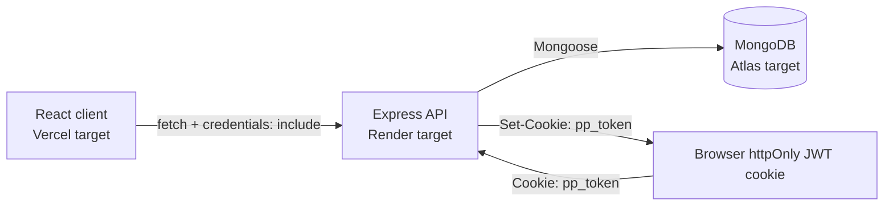

# PlanPilot

> A full-stack task-management workspace for planning and follow-through.

[](https://react.dev/)
[](https://vite.dev/)
[](https://expressjs.com/)
[](https://www.mongodb.com/)
[](https://motion.dev/)


Live demo: `<add link after deployment>`

Screenshots: add images under `docs/screenshots/` after they are captured.

## What it is

PlanPilot is a full-stack MERN portfolio project with a React task workspace and an Express API backed by MongoDB. The public site includes a demo billing system with Free, Pro, and Team plan states. No real payments exist or are processed.

## Features

### Public site

- Home, Features, Pricing, Reviews, About, Contact, Privacy, and Terms pages.
- Review listing and submission, with authenticated edit/delete for a user's own non-sample reviews.
- Contact form submission with validation and rate limiting.

### Workspace

- JWT-cookie authentication with signup, login, logout, and session lookup.
- Task CRUD, status columns, due dates, priorities, projects, tags, search, filters, and drag-and-drop ordering.
- Project CRUD with task progress, and team-member CRUD with names, emails, and roles.
- Calendar, analytics, overview, settings, and protected dashboard routes.
- Dark/light theme switching.

### Plans (demo)

- Free, Pro, and Team selection with monthly/yearly display and local plan-change history.
- Free plan: 25 active tasks, one workspace, board/search, calendar, and summary analytics.
- Pro plan: unlimited tasks, priority/project filters, and full analytics charts.
- Team plan: Pro features plus team directory, invites, roles, and shared project progress.
- Plan selection is local demo state; it does not change server permissions or process payments.

### Backend

- Express API for auth, tasks, reviews, contact messages, projects, and team members.
- MongoDB persistence through Mongoose and Zod request validation.
- Owner-scoped workspace queries and JSON error responses.

## Architecture



The hosting labels are deployment targets, not deployed environments in this repository.

## Tech stack

**Client:** React 18, React Router 6, Vite, Framer Motion, Tailwind CSS, custom CSS, dnd-kit, Recharts, Lucide React, Context API.

**Server:** Node.js 18+, Express 5, Mongoose, MongoDB, JWT, bcryptjs, Zod, cookie-parser, CORS, Helmet, Morgan, express-rate-limit.

## Run locally

Prerequisites: Node.js 18.11+ and a running MongoDB instance.

```bash
cp .env.example .env
cp server/.env.example server/.env
npm install
npm --prefix server install
npm run dev
```

`npm run dev` starts Vite and the API together. The client normally runs at `http://localhost:5173` and the API at `http://localhost:5000`.

## Environment variables

Values below are examples only. Do not commit real secrets.

### Client (`.env`)

| Variable | Example |
| --- | --- |
| `VITE_APP_NAME` | `PlanPilot` |
| `VITE_API_URL` | *(empty; uses the Vite `/api` proxy)* |

### Server (`server/.env`)

| Variable | Example |
| --- | --- |
| `PORT` | `5000` |
| `NODE_ENV` | `development` |
| `MONGODB_URI` | `mongodb://127.0.0.1:27017/planpilot` |
| `CLIENT_URL` | `http://localhost:5173` |
| `JWT_SECRET` | `replace-with-a-long-random-string-of-32-or-more-characters` |
| `JWT_EXPIRES_IN` | `7d` |

## API reference

All paths are relative to the API origin. JSON bodies are validated where a body is accepted.

| Method | Path | Auth | Description |
| --- | --- | --- | --- |
| POST | `/api/auth/signup` | No | Create an account and set the JWT cookie. |
| POST | `/api/auth/login` | No | Sign in and set the JWT cookie. |
| POST | `/api/auth/logout` | No | Clear the JWT cookie. |
| GET | `/api/auth/me` | Yes | Return the current user. |
| GET, POST | `/api/tasks` | Yes | List or create owned tasks. |
| PATCH | `/api/tasks/reorder` | Yes | Reorder owned tasks. |
| PATCH, DELETE | `/api/tasks/:id` | Yes | Update or delete an owned task. |
| GET, POST | `/api/reviews` | GET no; POST optional | List reviews or create a review. |
| PATCH, DELETE | `/api/reviews/:id` | Yes | Update or delete the signed-in user's non-sample review. |
| POST | `/api/contact` | No | Save a contact message. |
| GET, POST | `/api/projects` | Yes | List or create owned projects. |
| GET, PATCH, DELETE | `/api/projects/:id` | Yes | Read, update, or delete an owned project. |
| GET, POST | `/api/team` | Yes | List or create owned team members. |
| GET, PATCH, DELETE | `/api/team/:id` | Yes | Read, update, or delete an owned team member. |
| GET | `/api/health` | No | Return API and MongoDB connection status. |

## Security notes

- Passwords are hashed with bcrypt cost 12.
- Authentication uses a JWT in the `pp_token` httpOnly cookie; production cookies use `secure` and `SameSite=None`.
- Zod validates request bodies before controllers receive them.
- Task, project, and team queries are owner-scoped; missing or foreign records return 404. Review updates and deletes are also author-scoped and return 404.
- Auth is limited to 30 attempts per 15 minutes, reviews to 10 submissions per hour, and contact messages to 5 per hour.
- Helmet is enabled, CORS uses the configured client origin with credentials, and JSON bodies are limited to 100 KB.

## Data and persistence

MongoDB stores users, tasks, reviews, contact messages, projects, and team members. The client calls the API for those records. Browser `localStorage` stores only the `pp_theme` theme preference and `pp_plan` demo plan, billing-cycle, and plan-history state.

## Project structure

```text
.
├── src/
│   ├── components/     # Layout and reusable UI
│   ├── context/        # Auth, tasks, projects, team, theme, plan, toast
│   ├── data/           # Client display data and plan definitions
│   ├── pages/          # Public and dashboard route pages
│   ├── routes/         # Protected route
│   ├── services/       # API client and local storage boundary
│   └── utils/
├── server/src/
│   ├── config/         # MongoDB connection
│   ├── controllers/
│   ├── middleware/     # Auth and Zod validation
│   ├── models/         # Mongoose models
│   ├── routes/
│   ├── utils/
│   ├── validators/
│   ├── app.js
│   └── server.js
├── .env.example
└── server/.env.example
```

## Plans and limits

| Plan | Implemented limits and features | Not implemented |
| --- | --- | --- |
| Free | 25 active tasks, one workspace, board/search, calendar, summary analytics | — |
| Pro | Unlimited tasks, one workspace, priority/project filters, full analytics charts | Saved filters, recurring tasks, priority support |
| Team | Pro features, team directory, invites/roles, shared project progress | Activity log, real-time collaboration, admin controls |

## Accessibility and performance

- Task drag-and-drop includes pointer, touch, and keyboard sensors.
- Focus-visible outlines, labeled navigation, live status messages, and reduced-motion CSS are implemented.
- Routes are lazy-loaded with a loading fallback.
- Vite splits React, motion, charts, and dnd-kit vendor chunks in production builds.

## Roadmap

- Add Vitest and React Testing Library tests.
- Add GitHub Actions CI.
- Deploy the client to Vercel, API to Render, and database to MongoDB Atlas.
- Add real-time collaboration and recurring tasks.
- Move plan state and limits to the server.

## License

MIT. See [LICENSE](LICENSE).

## Claims not verified in the code

- No live demo URL or deployed Vercel, Render, or MongoDB Atlas environment is present in the repository.
- `docs/screenshots/` is a requested placeholder; no screenshots are currently included.
